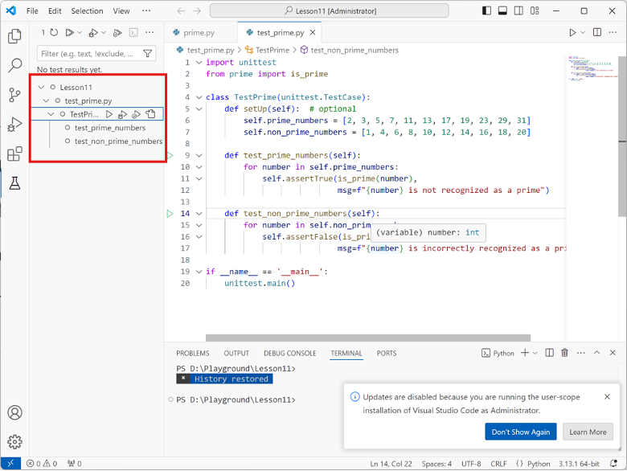

# Bug Report

This report documents the bugs discovered in the buggy programs, including the failing test cases, root cause analysis, and the applied code fixes.

---

## Bug Report 1: (Example)

### 1. Program Under Test
- **File:** `problemX.py`
- **Class / Function:** `YourClassName.method_name()`

### 2. Failing Test Case
Provide the unit test code from `test_problemX.py` that exposed the bug and failed during execution:

```python
# Paste your failing test method here
def test_example_failure(self):
    pass
```

Provide the captured test runs from VSCode.



**Test Output / Error Message:**
```text
# Paste error traceback / assertion failure message here
```

### 3. Root Cause Analysis
Explain why the bug occurred and what incorrect behavior it caused:
- **Expected Behavior:** (What should happen according to the specifications)
- **Actual Behavior:** (What happened in the starter code)
- **Root Cause:** (Explanation of the bug in the code logic)

### 4. Code Fix & Diff
Show the changes made to `problemX.py` to fix the bug:

```diff
- # Original buggy code line
+ # Corrected code line
```

---

## Bug Report 2: (Your discovery)

Write down your discovered bugs and solutions to address them as above. You may add more bug reports if needed.